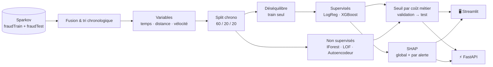
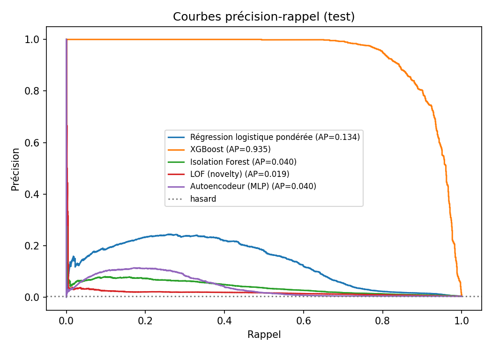
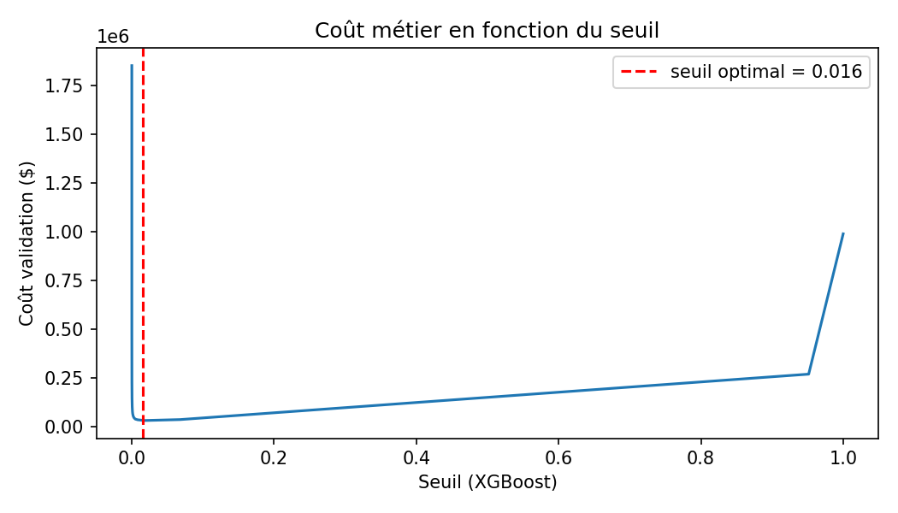
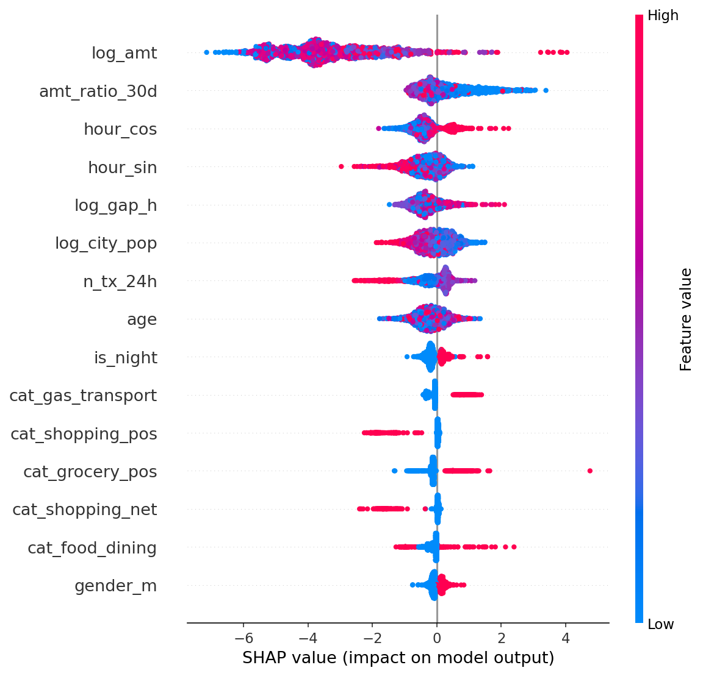

<div align="center">

# 🛡️ Détection de fraude explicable

### Application web interactive · Apprentissage supervisé & non supervisé · Seuil piloté par le coût métier · SHAP


**Data Mining · II3-IA · ENSI · 2026-2027** — Challenge 2
Jeu de données : *Credit Card Transactions Fraud Detection* (simulateur **Sparkov**, ~1,85 M de transactions)

</div>

---

## 📌 En bref

Les équipes anti-fraude ne peuvent examiner qu'une fraction des transactions. Ce projet leur fournit **un outil qui classe les transactions par niveau de risque, signale les plus suspectes et explique pourquoi**.

| | |
|---|---|
| 🎯 **Problème** | Détecter une fraude rarissime (~0,58 % des transactions) avec un budget d'analyse limité |
| 🧠 **Approche** | XGBoost et régression logistique pondérée, comparés à 3 détecteurs d'anomalies non supervisés |
| 💰 **Décision** | Seuil d'alerte choisi en **minimisant un coût en dollars** (fraudes manquées + coût d'analyse) |
| 🔍 **Confiance** | Chaque alerte est expliquée : graphique SHAP waterfall et *codes motifs* |
| 🌐 **Livrables** | Application Streamlit interactive + API REST FastAPI |

---

## 🏗️ Architecture



---

## ✨ Fonctionnalités

### 1 · Données
Taux de fraude, distribution des montants par classe, évolution mensuelle du taux de fraude, taux par heure, par jour de la semaine et par catégorie de marchand.

### 2 · Variables, sans fuite de données
| Famille | Variables |
|---|---|
| Temporelles | Heure en **codage cyclique** (sin/cos), jour de la semaine, week-end, nuit |
| Géographiques | Distance client ↔ marchand (haversine), taille de la ville |
| Comportementales | Nb de transactions sur **1 h** et **24 h**, montant rapporté à la **moyenne des 30 derniers jours**, délai depuis la transaction précédente |

> 🔒 **Anti-fuite** : chaque variable comportementale n'utilise que les transactions *strictement antérieures* de la même carte. Un test unitaire le vérifie (`tests/test_core.py`).

### 3 · Validation chronologique
Les fichiers d'origine sont fusionnés puis découpés **60 % entraînement / 20 % validation / 20 % test** dans l'ordre du temps, comme en production : le futur n'est jamais utilisé pour apprendre le passé.

### 4 · Déséquilibre extrême
Trois stratégies appliquées **au seul jeu d'entraînement** et comparées en validation : aucune, pondération (`scale_pos_weight`), sous-échantillonnage 10:1.

### 5 · Modèles comparés

| Famille | Méthode |
|---|---|
| Supervisé | Régression logistique pondérée |
| Supervisé | **XGBoost** (modèle expliqué) |
| Non supervisé | Isolation Forest |
| Non supervisé | Local Outlier Factor (novelty) |
| Non supervisé | Autoencodeur (réseau de reconstruction) |

### 6 · Évaluation adaptée aux événements rares
PR-AUC, ROC-AUC, **précision@k** et **rappel@k** pour un budget d'alertes *k*, puis F2 et MCC au seuil retenu. Courbes précision-rappel superposées.

### 7 · Seuil piloté par le coût métier

```
Coût total = Σ montants des fraudes manquées  +  coût d'analyse × nombre d'alertes
```

Le seuil optimal est choisi par balayage exact sur la **validation**, puis **confirmé sur le test**. Dans l'application, deux curseurs (seuil et budget) mettent à jour en direct les alertes, la précision, le rappel, le F2, le MCC et le coût.

### 8 · IA explicable
- **Explication globale** : SHAP beeswarm
- **Explication d'une alerte** : SHAP waterfall + **codes motifs** (les 3 à 5 variables qui ont le plus poussé le score vers « fraude »)

### 9 · API REST (FastAPI)

| Endpoint | Rôle |
|---|---|
| `POST /predict` | Score, décision d'alerte et codes motifs |
| `POST /explain` | Contributions SHAP complètes |
| `POST /predict/batch` | Scoring d'un lot de transactions |
| `GET /model-info` | Seuil, hypothèses de coût, métriques de test |
| `GET /health` | État du service |

Documentation interactive automatique sur `/docs`.

---

## 📊 Résultats

> Les chiffres ci-dessous sont à remplir après exécution du pipeline sur le jeu complet (`artifacts/results.json`).

| Modèle | Type | PR-AUC test | Précision@k | Rappel@k | F2 | MCC | Coût test |
|---|---|---|---|---|---|---|---|
| Régression logistique | Supervisé | | | | | | |
| **XGBoost** | Supervisé | | | | | | |
| Isolation Forest | Non supervisé | | | | | | |
| LOF | Non supervisé | | | | | | |
| Autoencodeur | Non supervisé | | | | | | |

<table>
<tr>
<td></td>
<td></td>
</tr>
<tr>
<td colspan="2" align="center"></td>
</tr>
</table>

*Les figures sont générées par `python run_pipeline.py` dans `artifacts/figures/`.*

---

## 🚀 Démarrage rapide

```bash
git clone https://github.com/HadilBousnina/Fraud-Detection.git
cd Fraud-Detection

python -m venv .venv
.venv\Scripts\activate            # Linux/macOS : source .venv/bin/activate
python -m pip install -r requirements.txt

python run_pipeline.py            # données + entraînement + artefacts + figures
python -m streamlit run app/streamlit_app.py
python -m uvicorn api.main:app --reload     # API : http://127.0.0.1:8000/docs
python -m pytest -q               # tests unitaires
```

**Données** : le pipeline cherche `fraudTrain.csv` et `fraudTest.csv` dans `--data`, puis `./data`, puis `/kaggle/input`, et sinon les télécharge via `kagglehub` (`kartik2112/fraud-detection`). Option `--max-rows 300000` pour un essai rapide.

### Exemple d'appel API

```bash
curl -X POST http://127.0.0.1:8000/predict -H "Content-Type: application/json" -d '{
  "trans_date_trans_time": "2020-06-21 02:14:00", "amt": 842.5, "category": "shopping_net",
  "gender": "M", "lat": 36.0, "long": -81.2, "merch_lat": 36.3, "merch_long": -81.5,
  "city_pop": 3495, "dob": "1985-04-12",
  "n_tx_1h": 3, "n_tx_24h": 6, "amt_ratio_30d": 9.0, "time_since_prev_h": 0.2
}'
```

Réponse : `fraud_probability`, `alert`, `threshold` et `reason_codes` (motif, valeur, contribution SHAP).

---

## ⚙️ Hypothèses métier

Paramétrables dans [`src/config.py`](src/config.py) :

| Paramètre | Valeur | Signification |
|---|---|---|
| `BUDGET_FRAC` | 1 % | Part des transactions que les analystes peuvent examiner |
| `REVIEW_COST` | 5 $ | Coût d'analyse d'une alerte |
| `SPLIT` | 60/20/20 | Découpage chronologique |

Ces valeurs sont des **hypothèses de travail** : le seuil optimal et le classement des modèles dépendent directement d'elles.

---

## 🗂️ Structure du dépôt

```
├── run_pipeline.py          # Point d'entrée du pipeline
├── src/
│   ├── config.py            # Paramètres et hypothèses métier
│   ├── data.py              # Chargement + split chronologique
│   ├── features.py          # Variables temporelles, géo, vélocité
│   ├── metrics.py           # PR-AUC, précision@k, F2, MCC, coût, seuil optimal
│   ├── explain.py           # SHAP exact + codes motifs
│   └── pipeline.py          # Entraînement, comparaison, artefacts, figures
├── app/streamlit_app.py     # Application web (4 pages)
├── api/main.py              # API FastAPI
├── tests/test_core.py       # Tests : anti-fuite, split, coût, précision@k
├── scripts/make_synthetic.py  # Mini-jeu factice pour tester sans Kaggle
└── artifacts/               # Généré : modèle, scores, résultats, figures
```

---

## ⚠️ Limites

- **Données synthétiques** : les schémas de fraude sont ceux du simulateur ; les performances seront plus optimistes que sur des données bancaires réelles.
- **Coût d'analyse constant** et indépendant du montant ou de la complexité du dossier.
- **Pas de boucle de rétroaction** : les décisions des analystes ne réalimentent pas le modèle.
- **Dérive temporelle** : le comportement des fraudeurs évolue, un réentraînement régulier serait nécessaire.
- Les variables comportementales de l'API sont fournies par l'appelant ; en production, elles viendraient d'un *feature store*.

---

## 👩‍💻 Auteure

**Hadil Bousnina** — Élève ingénieure en informatique, option IA, ENSI
Encadrement : Rym Besrour — Module Data Mining, ENSI 2026-2027

Jeu de données : [Credit Card Transactions Fraud Detection (Kaggle)](https://www.kaggle.com/datasets/kartik2112/fraud-detection) — vérifier la licence sur la page du jeu.
